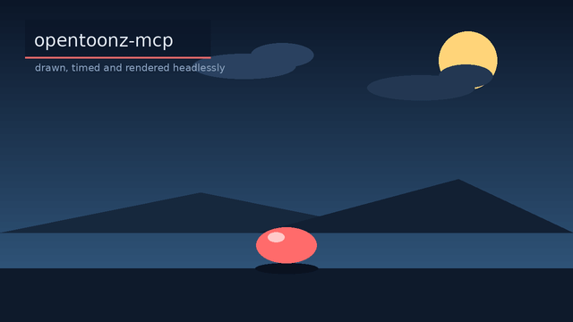
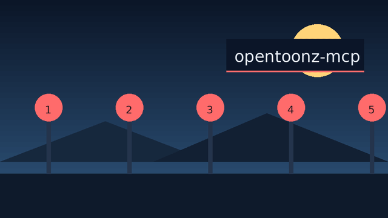

# opentoonz-mcp

**Headless OpenToonz automation for AI agents — as a [Model Context Protocol](https://modelcontextprotocol.io) server.**

`opentoonz-mcp` lets an agent drive [OpenToonz](https://github.com/opentoonz/opentoonz) — levels, xsheets, cells, rendering, video — entirely from the command line. No GUI, no plugin build, no mouse.

It works by running OpenToonz's **built-in scripting engine** in CLI mode and the official **`tcomposer`** headless renderer, then exposing the useful primitives as MCP tools.

[](https://github.com/c0d33ngr/opentoonz-mcp/actions/workflows/ci.yml)
[](https://github.com/c0d33ngr/opentoonz-mcp/blob/main/LICENSE)
[](https://github.com/c0d33ngr/opentoonz-mcp)
[](https://github.com/astral-sh/ruff)



<sub>Three separately drawn levels — background, ball, title — stacked as columns on
the xsheet, the static ones held with `opentoonz_exposure`, and composited by
OpenToonz's own renderer. Reproduce it with
[`examples/demo_reel.py`](examples/demo_reel.py).</sub>



<sub>The camera moving over a *static* scene — pan and zoom written into the
scene's own camera channels, with the push-in eased so it settles instead of
stopping dead. Reproduce it with
[`examples/camera_move.py`](examples/camera_move.py).</sub>

---

## Why

OpenToonz is a deep, industry-grade 2D animation suite, but its scripting API is headless-only and awkward to reach. This server turns the validated, hard-won runtime recipe into a small, safe, well-documented tool surface an agent can actually use:

- **Create a workspace** → **draw or import frames as a level** → **place cells on the xsheet** → **move the camera** → **render a frame to look at it** → **render a video**.
- A generic `opentoonz_run_script` escape hatch exposes the rest of the JS API.
- Runs stay **self-contained**: an isolated `HOME` and a shared `TOONZROOT`, so nothing leaks into your real OpenToonz config.

## How it works

```
MCP client (agent)
      │  tool calls (stdio)
      ▼
opentoonz-mcp server
      │  writes <workspace>/scripts/*.toonzscript  +  PIL-drawn RGBA frames
      ▼
OpenToonz CLI  (script mode, no window)
      │
      ▼
tcomposer  (official headless renderer)  →  PNG frames  →  ffmpeg  →  MP4
```

> The extracted AppImage binary is run **directly** — its `AppRun` launcher mangles CLI arguments and drops into GUI mode.

## Requirements

| Requirement | Notes |
|---|---|
| Python | 3.10+ |
| OpenToonz | v1.x with `tcomposer`. On Linux, an extracted AppImage works best. |
| ffmpeg | Only for `opentoonz_render_video` / `opentoonz_render_gif` |

See **[docs/installation.md](docs/installation.md)** for how to obtain and point at a runtime.

## Install

```bash
# from GitHub (no clone needed)
pipx install git+https://github.com/c0d33ngr/opentoonz-mcp.git
# or, pinned to a release
pipx install "git+https://github.com/c0d33ngr/opentoonz-mcp.git@v0.6.0"
# or, from a checkout
pipx install .
# or
uv tool install .
# or for development
pip install -e ".[dev]"
```

The `opentoonz-mcp` console script starts the stdio server. It also bootstraps the
OpenToonz runtime, so an installed copy needs no clone:

```bash
opentoonz-mcp fetch-runtime --appimage ~/Downloads/OpenToonz.AppImage
```

## Configure your MCP client

**OpenCode** (`~/.config/opencode/opencode.jsonc`):

```jsonc
{
  "mcp": {
    "opentoonz": {
      "type": "local",
      "command": ["opentoonz-mcp"],
      "enabled": true,
      "environment": {
        "OPENTOONZ_RUNTIME": "/path/to/opentoonz/squashfs-root"
      }
    }
  }
}
```

**Claude Desktop / Cursor** (`mcpServers`):

```json
{
  "mcpServers": {
    "opentoonz": {
      "command": "opentoonz-mcp",
      "env": { "OPENTOONZ_RUNTIME": "/path/to/opentoonz/squashfs-root" }
    }
  }
}
```

## Quickstart

Ask your agent to:

1. `opentoonz_create_workspace("my-short")`
2. `opentoonz_draw_frames(...)` — draw a few RGBA frames, **or** generate PNGs elsewhere
3. `opentoonz_import_images_as_level(...)` — bring them in as a level
4. `opentoonz_exposure(...)` — hold each drawing for N frames (`[2]` = on 2s)
5. `opentoonz_camera_move(...)` — pan, zoom or rotate the camera over the shot
   (add `"ease": true` to a keyframe to soften that part of the move)
6. `opentoonz_render_frame(..., max_width=960)` — look at the result cheaply
7. `opentoonz_render_video(...)` — get an MP4 (or `opentoonz_render_gif` for a GIF)

Draw at the scene's resolution (`opentoonz_scene_new(width=..., height=...)` to change
it from the 1920×1080 default) — levels composite 1:1, so art drawn at the scene's
size fills the frame.

Or run the examples end-to-end:

```bash
OPENTOONZ_RUNTIME=/path/to/squashfs-root python examples/bouncing_ball.py  # one level → MP4
OPENTOONZ_RUNTIME=/path/to/squashfs-root python examples/demo_reel.py     # three levels → MP4 + the GIF above
OPENTOONZ_RUNTIME=/path/to/squashfs-root python examples/camera_move.py   # eased camera move → GIF
```

## Tools

| Tool | Purpose |
|---|---|
| `opentoonz_health` | Quick availability check |
| `opentoonz_doctor` | Full diagnostics (paths, versions, state; `smoke=true` runs a real script) |
| `opentoonz_create_workspace` | Create a workspace (idempotent) |
| `opentoonz_list_workspaces` | Inventory workspaces/scenes/videos |
| `opentoonz_clean` | Delete generated files to reclaim disk space (needs `confirm=true`) |
| `opentoonz_delete_workspace` | Remove a whole workspace (needs `confirm=true`) |
| `opentoonz_scene_new` | Create a scene, optionally setting resolution/fps |
| `opentoonz_set_scene_settings` | Change camera resolution / fps |
| `opentoonz_import_images_as_level` | Image sequence → raster level (additive, re-runnable) |
| `opentoonz_extract_frames` | Video → PNG drawings, as a level (via ffmpeg) |
| `opentoonz_scene_info` | Frames/columns/levels/cells |
| `opentoonz_set_cells` | Place cells on the xsheet |
| `opentoonz_exposure` | Hold each drawing for N frames (animate on 1s/2s/3s) |
| `opentoonz_camera_move` | Animate the camera (pan / zoom / rotate), with per-segment easing |
| `opentoonz_draw_frame` | Draw one RGBA frame (PIL primitives + image compositing) |
| `opentoonz_draw_frames` | Draw a whole sequence |
| `opentoonz_tween_frames` | Tween a drawing between two poses (move/scale/rotate/fade) |
| `opentoonz_render_frame` | Render one frame, returned inline as an image |
| `opentoonz_render` | Render PNG frames via `tcomposer` (optional frame range) |
| `opentoonz_render_video` | Render + ffmpeg → MP4 (optional audio, crf, scale) |
| `opentoonz_render_gif` | Render + ffmpeg → looping GIF |
| `opentoonz_render_batch` | Render every scene in a workspace (frames/video/gif) in one call |
| `opentoonz_run_script` | Arbitrary OpenToonz JS (escape hatch) |

Full reference, including the drawing-op schema: **[docs/tools.md](docs/tools.md)**.
The data-returning tools also return structured content (see
**[docs/architecture.md](docs/architecture.md)**), so results can be read as
fields rather than parsed from text.

## Limitations

OpenToonz's JS API is a **subset** of the GUI, and some of the boundaries are sharp:

- FX graphs, palette editing, camera **splines**, auto-inbetweening, and audio
  tracks are unreachable. There is also **no way to delete** a level or a cell,
  which is why level import *reuses* an existing level instead of replacing it.
  Camera *moves* (pan/zoom/rotate) do work, including **eased** segments — they
  are written into the camera's stage-object channels, which OpenToonz renders and
  keeps editable.
- **Vector (SVG) levels import but render blank** headlessly, and `setFrame()` on
  a loaded level never reaches the renderer. Raster PNG levels are the supported
  path; passing an SVG to the import tool is rejected with that explanation.
- Camera resolution is **not** scriptable, so `opentoonz_set_scene_settings`
  patches the scene file's XML — keeping the camera's physical size in step, so
  art drawn at the scene's size fills the frame.
- Rendering needs a working `tcomposer`; `Renderer.renderFrame` **deadlocks** in
  CLI mode and is intentionally avoided.
- Exercised on **Linux** only so far. Workspace locking uses `fcntl`; on Windows
  it degrades to a no-op (and warns once) rather than failing.

Workarounds and the full picture: **[docs/runtime-notes.md](docs/runtime-notes.md)**.

## Troubleshooting

See **[docs/troubleshooting.md](docs/troubleshooting.md)** — it covers the common failure modes (GUI-mode hangs, black renders, `tcomposer` exceptions).

## Development

```bash
pip install -e ".[dev]"
pytest -m "not e2e"      # fast unit tests
pytest -m e2e            # requires a runtime (OPENTOONZ_RUNTIME=...)
ruff check . && ruff format --check .
python -m build          # packaging check
```

The `e2e` suite needs a real OpenToonz runtime, so it is not part of the push/PR
gate. To run it in CI on demand — or weekly — see
**[`.github/workflows/e2e.yml`](.github/workflows/e2e.yml)**.

Architecture notes live in **[docs/architecture.md](docs/architecture.md)**.

## License & attribution

MIT — see [LICENSE](LICENSE). This is an unofficial project and is **not** affiliated with OpenToonz. OpenToonz is BSD-3-Clause and is **not** bundled here. See [NOTICE](NOTICE).
